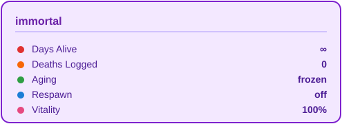
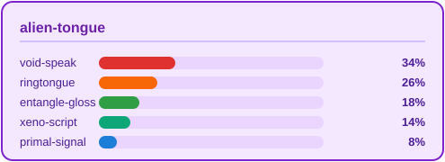
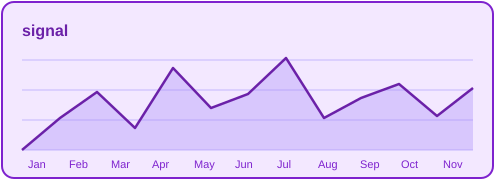

<!--
  PUNK / GEEK PROFILE README — DEMO TEMPLATE
  placeholder username: aspd199  (replace with your real GitHub username)
  all repos are fictional demos, not real projects — swap as needed
  palette: light violet #c084fc / mid lavender #a78bfa / deep violet #6b21a8 / gradient end #7e22ce
  NOTE: GitHub sanitizes CSS. This file relies entirely on SVG images + ASCII + native markdown. No <style>.
-->

<!-- ===================== HERO ===================== -->

  

  

<!-- ===================== STATUS BAR ===================== -->

<!-- ===================== MANIFESTO ===================== -->
## ▓ MANIFESTO

> `$` I don't ask for permission. I fork reality.
>
> `$` Code is graffiti on the wall; compiled, it's dynamite.
>
> `$` I don't chase trends. I write my own kernel.
>
> `$` Immortality is too mainstream. I just want to leave Earth, open a tea room, and chat life with aliens over tea.
>
> `$` Systems crash, docs expire — only `rm -rf /` stays honest.

<!-- ===================== THE ARSENAL ===================== -->
## ▓ THE ARSENAL

> `$ cat ~/.toolchain`

<!-- ===================== BREACHES / BUILDS ===================== -->
## ▓ BREACHES / BUILDS

<b>▸ BUILT</b>

 

| Project | Class | Description | Stack |
|:---|:---:|:---|:---:|
| [**void-shell**](https://github.com/aspd199/void-shell) | 🐚 shell | a minimal shell that calls the terminal home; boots straight into `root@void:~#` |  |
| [**neon-glitch**](https://github.com/aspd199/neon-glitch) | ✨ lib | terminal / SVG glitch-art generator — pure algorithm, zero deps |  |
| [**ascii-forge**](https://github.com/aspd199/ascii-forge) | 🎨 tool | forge any image into ASCII posters |  |
| [**tea-protocol**](https://github.com/aspd199/tea-protocol) | 👽 proto | handshake protocol for tea & life talks with aliens (draft) |  |

<b>▸ BREACHED</b>

 

| Project | Class | Description | Stack |
|:---|:---:|:---|:---:|
| [**no-permission**](https://github.com/aspd199/no-permission) | 🔓 util | a tiny toy that auto-forks reality (joke) |  |
| [**earth-exit**](https://github.com/aspd199/earth-exit) | 🚀 nav | offline navigation draft for leaving Earth |  |

<!-- ===================== SURVEILLANCE ===================== -->
## ▓ SURVEILLANCE

<!-- ===================== TRANSMISSION ===================== -->
## ▓ OPEN A CHANNEL

---

  <i>"we are the geeks they couldn't silence."</i>
  

